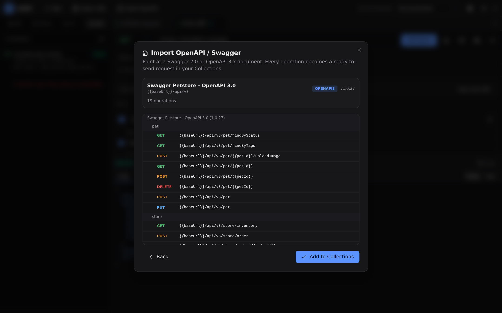
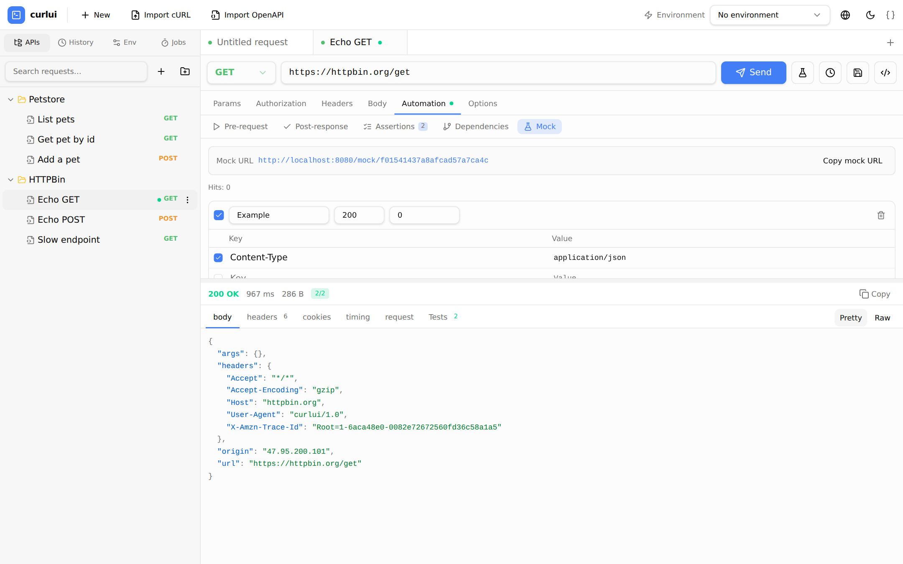

# curlui

**A self-hosted HTTP client that runs every request in Go.** No CORS, no
mixed-content blocks — call `localhost` and internal APIs, see real per-phase
network timings, and keep everything on your own machine.

Ships as **one self-contained binary** (UI embedded): Postman-style editing, a
capture proxy, mocks, fuzzing, gRPC, GraphQL, MCP for AI agents — and optional
teams. No account, no cloud.


## Why curlui

- **Requests run server-side (Go)** — not in the browser. Private/loopback
  targets work, TLS is fully controllable, and you get DNS / connect / TLS / TTFB
  waterfall timings.
- **One binary, self-hosted** — the React UI is embedded; data lives in a JSON
  file or PostgreSQL. Nothing to install, nothing phones home.
- **All the tools in one place** — editor, collections, environments, mocks,
  capture proxy, fuzzer, scheduler, gRPC, GraphQL, docs export.
- **AI-ready** — a built-in MCP server lets agents drive your saved requests.
- **Anonymous by default** — every feature works without logging in; turn on
  *Require login* only when you want teams.

## Features

**Client** · methods, params, headers, bodies (JSON / XML / HTML / text / form /
form-data with file upload / binary / **GraphQL**), auth (basic, bearer, API key,
OAuth2, JWT, AWS SigV4, Digest), cookie jar, client certs, cURL import/export,
timeout / redirects / TLS / proxy options.

**Organize** · nested collections with drag-and-drop, folder variables and setup
requests, environments and `{{variables}}`, history, multi-tab editing,
deep links (`#/r/<uuid>`), duplicate, copy-as-cURL.

**Test & automate** · pre/post hooks (any language via stdin/stdout JSON),
assertions (status / time / header / body / JSON-path) with a live pass/fail
indicator, request chaining + extraction, mock responses (`/mock/{id}`),
concurrent folder runner, load tests, fuzzer (reflection, SSTI, error leaks,
timing, path/header/cookie/body injection), delayed & periodic jobs.

**Observe** · capture proxy with HTTPS decryption (CA), per-host filtering,
request/response **breakpoints**, replay, save-to-collection, HAR/cURL export.
The proxy is **started/stopped from the UI** and remembered across restarts.

**Streaming** · **live SSE / chunked** responses render as they arrive (a
*Stream* toggle next to Send; the button becomes *Stop* to abort), with a
**Chunks** view (size / delta / ms per chunk), pause + auto-scroll, a structured
**Events** view (`id` / `event` / `data` / `retry`) and **SSE auto-reconnect**
that resumes from `Last-Event-ID`; a **WebSocket console** connects through the
server bridge to any `ws://` / `wss://` target — custom headers,
**subprotocols**, **binary frames**, self-signed TLS, close codes, a manual
**ping** (RTT) and a live frame log; **gRPC streaming** (server / client /
**interactive bidi** — send and receive at the same time, with half-close,
deadline and gzip) prints every message, header and trailer as it lands.

**Interop** · import OpenAPI/Swagger (URL or file) and Postman v2.1 collections;
export as JSON, cURL, Postman, or rendered docs (**Markdown / HTML / Word /
PDF**); gRPC via `.pb` descriptors or server reflection — **calls save into
collections** (reopen, export, share); GraphQL schema introspection.

**Team** · optional login (local accounts or **OIDC/SSO**), isolated projects,
roles (owner/admin/member/viewer), audit log, shared workspaces that refresh for
everyone.

**Extras** · dark / light / **auto** themes, English / 简体中文 / 日本語 (or
**auto** from the browser), resizable & collapsible panels (left, right, bottom
with maximize), response search + **JSONPath filter** + save-to-file, responsive
phone layout, self-update, run as a system service, custom User-Agent.

## Two builds: full & core

Every release ships two single-file binaries:

| | **full** | **core** |
| --- | --- | --- |
| Everything (gRPC + gRPC streaming, PostgreSQL, capture proxy, MCP, jobs, PDF) | ✅ | — |
| HTTP client, collections, environments, history, cURL/OpenAPI/Postman, GraphQL, mocks, assertions, live streaming (SSE + WebSocket), docs (MD/HTML/Word) | ✅ | ✅ |
| Size (linux/amd64, stripped) | ~22 MB | **~9 MB** |

```sh
curl -fsSL .../install.sh | sh                      # full
CURLUI_VARIANT=core curl -fsSL .../install.sh | sh  # core
```

The UI adapts automatically: the core build hides gRPC, the traffic/proxy panel,
jobs, MCP settings, team/login, OpenAPI import, docs export and PDF — so the UI
always matches what the binary can actually do.

## Install

```sh
curl -fsSL https://raw.githubusercontent.com/holihur/curlui/main/install.sh | sh   # macOS / Linux
```

```powershell
irm https://raw.githubusercontent.com/holihur/curlui/main/install.ps1 | iex       # Windows
```

Then:

```bash
curlui                 # open http://localhost:8080
```

Prefer manual? Grab a self-contained archive for your platform from
[Releases](https://github.com/holihur/curlui/releases) and run the single file.
`curlui -version` / `curlui -help` for details.

## Run from source

Requires Go 1.25+ and Node 20+.

```bash
make build      # build UI + server → server/curlui-server
make dev        # server on :8080 + Vite on :5173 (hot reload)
```

## Configuration

| Flag | Env | Default | Purpose |
| --- | --- | --- | --- |
| `-addr` | `CURLUI_ADDR` | `:8080` | Listen address |
| `-db` | `CURLUI_DATABASE_URL` | — | PostgreSQL DSN (else a JSON file) |
| `-data` | `CURLUI_DATA` | `data/store.json` | JSON store path |
| `-pprof` | `CURLUI_PPROF` | off | `:6060`, or `main` for `/debug/pprof` on the main port |
| `-mcp` | — | — | MCP server over stdio |
| `-service` | — | — | `install` / `uninstall` / `status` / `print` |

The capture proxy is **toggled from the UI** (Traffic panel), not a flag; its
address and on/off state are remembered.

With `-db`, the schema is auto-migrated and an existing `data/store.json` is
imported once. The default `local` project keeps anonymous use working.

## Screenshots

| Import OpenAPI | Automation (hooks, assertions, chaining) |
| --- | --- |
|  |  |
| **Mocks** | **Scheduler** |
|  |  |

<details><summary>Light theme · phone · tablet</summary>

| Light | Phone | Drawer | Tablet |
| --- | --- | --- | --- |
|  |  |  |  |

</details>

> Screenshots are stored in **Git LFS** and refreshed automatically
> (`bash scripts/screenshots.sh`, or the CI `screenshots` workflow).

## Variables

`{{name}}` resolves from the active environment (plus folder variables and
parent extractions). Dynamic: `{{$timestamp}}` `{{$isoTimestamp}}` `{{$uuid}}`
`{{$randomInt}}`.

## Automation

**Hooks** are child processes: JSON in on **stdin**, JSON out on **stdout** — so
they can be shell, Python, Node, Go…

```jsonc
// pre-request  stdout          // post-response stdout
{"variables":{"token":"abc"}}   {"variables":{"id":1},
 "request":{"method":"GET"}}     "tests":[{"name":"status 200","passed":true}]}
```

**Assertions** check `status / time / header / body / jsonpath` with
`eq ne contains matches gt gte lt lte exists`; the sidebar indicator goes green
or red.

**Chaining**: a request can depend on parents; their **Extract** rules pull JSON
values (e.g. `$.data.token`) into variables for descendants. Folders can carry
variables + a setup request so children inherit them automatically.

## AI agents (MCP)

```bash
curlui -mcp      # MCP over stdio; also POST /mcp
```

Read tools (collections, environments, history, captures, intercepts) and write
tools (http_request, run_saved_request, create_request, replay_capture,
resolve_intercept, proxy_config, clear_captures), toggled in Settings.

## Notes

- `form-data` file fields and `binary` bodies reference paths on the machine
  running the server.
- TLS verification can be disabled per request (the `-k` equivalent).
- Profiling: `curlui -pprof :6060` (or `-pprof main` for `/debug/pprof` on the
  main port).
